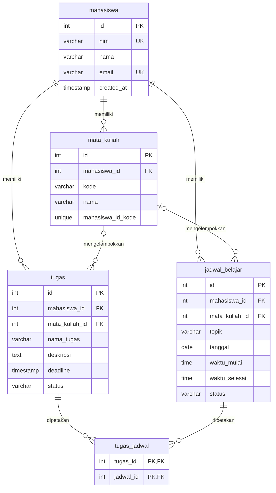

# Study Schedule Planner API

REST API untuk mengelola mahasiswa, mata kuliah, jadwal belajar, tugas kuliah, dan statistik belajar. Proyek backend ini memakai PostgreSQL relasional; frontend tidak termasuk ruang lingkup.

> Dokumen acuan asli `StudySchedulePlanner function list`, skema `.sql`, dan `projectakhir.md` tidak tersedia di workspace saat implementasi. Implementasi mengikuti spesifikasi rinci yang disertakan bersama tugas. Tidak ada URL deployment atau bukti uji Postman online yang diklaim.

## Fitur dan teknologi

- CRUD mahasiswa, mata kuliah, jadwal belajar, dan tugas.
- Perubahan status dengan PATCH, pemeriksaan bentrok jadwal, tenggat tugas, statistik periode, dan relasi many-to-many tugas/jadwal.
- TypeScript strict, Node.js 22+, Express 5, PostgreSQL (`pg`), Zod, Vitest, dan Supertest.
- Semua nilai SQL yang berasal dari request menggunakan parameter PostgreSQL.
- Lima tabel domain dengan PK/FK/UNIQUE/CHECK; tidak menggunakan ORM.

## Struktur

```text
api/                         # tidak diperlukan oleh pola Express Vercel saat ini
db/migrations/001_init.sql   # migrasi aman tanpa DROP
db/reset.sql                 # hanya untuk database lokal/test
docs/erd.dbml
postman/
src/app.ts                   # Express app yang diekspor untuk Vercel
src/server.ts                # server pengembangan lokal
src/config/                  # konfigurasi environment
src/db/                      # pool, migrasi, seed, reset, transaksi
src/routes/                  # routing dan validasi request per resource
src/services/                # validasi kepemilikan resource
src/utils/                   # skema input, waktu WIB, overlap, error
tests/                       # unit dan integrasi PostgreSQL
```

## Prasyarat dan penggunaan lokal

1. Pasang Node.js 22 atau lebih baru dan PostgreSQL 14+.
2. Buat database kosong untuk aplikasi dan database khusus tes. Jangan gunakan database produksi sebagai `TEST_DATABASE_URL`.
3. Dari folder proyek:

```powershell
npm install
Copy-Item .env.example .env
```

4. Isi `.env` dengan URL koneksi database Anda. `DATABASE_URL` wajib; untuk tes integrasi isi `TEST_DATABASE_URL` dengan database terpisah. Aktifkan `DATABASE_SSL=true` jika provider database lokal/online Anda mewajibkan TLS.
5. Jalankan migrasi dan (opsional) seed:

```powershell
npm run db:migrate
npm run db:seed
```

6. Jalankan server lokal:

```powershell
npm run dev
```

API lokal tersedia di `http://localhost:3000/api`. Health check `GET /api/health` juga memverifikasi koneksi database.

### Perintah

| Perintah | Fungsi |
| --- | --- |
| `npm run dev` | Server lokal dengan hot reload |
| `npm run build` | Typecheck dan kompilasi TypeScript ke `dist/` |
| `npm start` | Menjalankan hasil build |
| `npm test` | Unit test dan integrasi bila `TEST_DATABASE_URL` tersedia |
| `npm run db:migrate` | Menjalankan migrasi SQL yang belum tercatat |
| `npm run db:seed` | Memasukkan contoh data fiktif secara idempotent |
| `npm run db:reset` | Menghapus skema lokal/test; ditolak saat `NODE_ENV=production` |

Reset **menghapus seluruh tabel proyek**. Jalankan hanya pada database lokal/test yang benar.

### Environment variables

| Nama | Wajib | Keterangan |
| --- | --- | --- |
| `DATABASE_URL` | Ya | URL PostgreSQL (gunakan pooled connection string di Vercel) |
| `TEST_DATABASE_URL` | Untuk integrasi | Database khusus tes, harus berbeda dari `DATABASE_URL` |
| `NODE_ENV` | Tidak | `development`, `test`, atau `production` |
| `DATABASE_SSL` | Tidak | `true`/`false`; default `true` di production dan `false` di development |
| `PORT` | Tidak | Port server lokal, default `3000` |

`.env.example` hanya berisi placeholder. Jangan menyimpan connection string atau kredensial nyata di repository/Postman.

## Database dan ERD

Skema domain terdiri dari lima tabel berikut. `schema_migrations` adalah tabel infrastruktur migrasi, bukan tabel domain. Tiga indeks tambahan bersifat aditif dan diizinkan: `tugas_jadwal(jadwal_id)`, `jadwal_belajar(mata_kuliah_id)`, dan `tugas(mata_kuliah_id)`.



Untuk mengimpor ERD ke dbdiagram.io gunakan [`docs/erd.dbml`](./docs/erd.dbml).

## Aturan desain dan batasan

- **Isolasi data:** resource turunan berada di bawah `/api/mahasiswa/:mahasiswaId/...`; semua query memeriksa `mahasiswa_id` dari path, dan akses silang menghasilkan 404. Belum ada autentikasi, sehingga siapa pun yang mengetahui ID dapat mengakses data tersebut.
- **Waktu:** `DATE`, `TIME`, dan `TIMESTAMP` merepresentasikan waktu dinding WIB (`Asia/Jakarta`) tanpa offset. Logika “sekarang” memakai `NOW() AT TIME ZONE 'Asia/Jakarta'`; parser `pg` mempertahankan tanggal/waktu sebagai string.
- **Input waktu lokal:** tanggal `YYYY-MM-DD`; waktu `HH:MM` atau `HH:MM:SS`; deadline `YYYY-MM-DDTHH:MM[:SS]`. Offset dan `Z` ditolak. Jadwal tidak dapat melewati tengah malam.
- **Bentrok:** hanya interval jadwal belajar pada mahasiswa/tanggal yang sama. Overlap berarti `mulai baru < selesai lama` dan `selesai baru > mulai lama`; interval yang tepat bersinggungan tidak bentrok. Jadwal selesai tetap diperhitungkan. POST/PUT mengecek bentrok dan menulis dalam transaksi dengan advisory lock per mahasiswa.
- **Mendekati deadline:** status harus `belum selesai`; deadline lampau diklasifikasikan `terlambat`; rentang mendekati default 3 hari dan dapat diubah dengan `hari=1..30`.
- **Statistik:** periode default adalah minggu Senin-Minggu WIB; rentang kustom harus mengisi `dari` dan `sampai` bersama-sama dan maksimum 366 hari. Tugas dikelompokkan berdasarkan tanggal deadline karena skema tidak memiliki `completed_at`.
- **PUT/PATCH:** PUT mengganti seluruh field yang dapat diedit. Status hanya diubah melalui PATCH. Body dengan field tak dikenal ditolak.
- **Penghapusan:** menghapus mata kuliah mengubah referensi tugas/jadwal menjadi NULL; menghapus mahasiswa menghapus semua data turunannya (CASCADE).
- **Vercel:** dokumentasi terbaru menggunakan Express app yang diekspor langsung dari `src/app.ts`, sehingga tidak memerlukan `api/index.ts` dan rewrite catch-all lama. `vercel.json` hanya mengatur batas durasi function. Lihat [dokumentasi Express Vercel](https://vercel.com/docs/frameworks/backend/express).
- **Pool serverless:** satu `pg.Pool` per instance dengan `max: 5`, batas koneksi dan idle timeout; gunakan URL pooled database di Vercel.

## Pemetaan 13 fungsi inti

| # | Fungsi | Endpoint |
| --- | --- | --- |
| 1 | `getJadwalBelajar` | `GET /api/mahasiswa/:mahasiswaId/jadwal-belajar` dan `/:id` |
| 2 | `tambahJadwalBelajar` | `POST /api/mahasiswa/:mahasiswaId/jadwal-belajar` |
| 3 | `updateJadwalBelajar` | `PUT /api/mahasiswa/:mahasiswaId/jadwal-belajar/:id` |
| 4 | `hapusJadwalBelajar` | `DELETE /api/mahasiswa/:mahasiswaId/jadwal-belajar/:id` |
| 5 | `tandaiJadwalSelesai` | `PATCH /api/mahasiswa/:mahasiswaId/jadwal-belajar/:id/status` |
| 6 | `getTugas` | `GET /api/mahasiswa/:mahasiswaId/tugas` dan `/:id` |
| 7 | `tambahTugas` | `POST /api/mahasiswa/:mahasiswaId/tugas` |
| 8 | `updateTugas` | `PUT /api/mahasiswa/:mahasiswaId/tugas/:id` |
| 9 | `hapusTugas` | `DELETE /api/mahasiswa/:mahasiswaId/tugas/:id` |
| 10 | `tandaiTugasSelesai` | `PATCH /api/mahasiswa/:mahasiswaId/tugas/:id/status` |
| 11 | `cekTugasMendekatiDeadline` | `GET /api/mahasiswa/:mahasiswaId/tugas/mendekati-deadline` |
| 12 | `cekBentrokJadwal` | `GET .../jadwal-belajar/cek-bentrok`; juga guard POST/PUT |
| 13 | `getRekapStatistik` | `GET /api/mahasiswa/:mahasiswaId/statistik` |

## Referensi endpoint

Semua URL memakai placeholder `{BASE_URL}` dan JSON dikirim dengan header `Content-Type: application/json`. Error validasi: `400 {"error":"Validasi gagal","details":[{"field":"...","message":"..."}]}`. Data/route tidak ditemukan: `404 {"error":"... tidak ditemukan"}`; bentrok/nilai unik ganda: `409 {"error":"..."}`; kesalahan tak terduga: `500 {"error":"Terjadi kesalahan internal server"}`.

### Health check
- Method       : GET
- URL          : `{BASE_URL}/api/health`
- Deskripsi    : Memeriksa API dan koneksi database (`SELECT 1`).
- Headers      : Tidak diperlukan.
- Request Body : Tidak ada.
- Response Sukses (200): `{"message":"API dan database siap","data":{"status":"ok"}}`
- Response Error (500): `{"error":"Terjadi kesalahan internal server"}`

### Mahasiswa — `GET /api/mahasiswa`
- Method       : GET
- URL          : `{BASE_URL}/api/mahasiswa`
- Deskripsi    : Daftar mahasiswa.
- Headers      : Tidak diperlukan.
- Request Body : Tidak ada.
- Response Sukses (200): `{"data":[{"id":1,"nim":"...","nama":"...","email":null}],"meta":{"total":1}}`
- Response Error (500): `{"error":"Terjadi kesalahan internal server"}`

### Mahasiswa — `POST /api/mahasiswa`
- Method       : POST
- URL          : `{BASE_URL}/api/mahasiswa`
- Deskripsi    : Membuat mahasiswa.
- Headers      : `Content-Type: application/json`
- Request Body : `{"nim":"21114022610001","nama":"Aditia","email":null}` (`email` opsional).
- Response Sukses (201): `{"message":"Mahasiswa berhasil ditambahkan","data":{"id":1,"nim":"...","nama":"...","email":null}}`
- Response Error (400/409): Validasi gagal atau NIM/email sudah digunakan.

### Mahasiswa — `GET /api/mahasiswa/:mahasiswaId`
- Method       : GET
- URL          : `{BASE_URL}/api/mahasiswa/{mahasiswaId}`
- Deskripsi    : Detail mahasiswa.
- Headers      : Tidak diperlukan.
- Request Body : Tidak ada.
- Response Sukses (200): `{"message":"Data mahasiswa ditemukan","data":{"id":1,"nim":"...","nama":"...","email":null}}`
- Response Error (400/404): ID tidak valid atau mahasiswa tidak ditemukan.

### Mahasiswa — `PUT /api/mahasiswa/:mahasiswaId`
- Method       : PUT
- URL          : `{BASE_URL}/api/mahasiswa/{mahasiswaId}`
- Deskripsi    : Mengganti NIM, nama, dan email; kirim `email:null` untuk mengosongkan.
- Headers      : `Content-Type: application/json`
- Request Body : `{"nim":"21114022610001","nama":"Aditia","email":null}`
- Response Sukses (200): `{"message":"Mahasiswa berhasil diperbarui","data":{...}}`
- Response Error (400/404/409): Input tidak valid, mahasiswa tidak ditemukan, atau nilai unik telah dipakai.

### Mahasiswa — `DELETE /api/mahasiswa/:mahasiswaId`
- Method       : DELETE
- URL          : `{BASE_URL}/api/mahasiswa/{mahasiswaId}`
- Deskripsi    : Menghapus mahasiswa dan semua data turunannya.
- Headers      : Tidak diperlukan.
- Request Body : Tidak ada.
- Response Sukses (200): `{"message":"Mahasiswa berhasil dihapus beserta seluruh datanya","data":{"id":1}}`
- Response Error (400/404): ID tidak valid atau mahasiswa tidak ditemukan.

### Mata kuliah — `GET /api/mahasiswa/:mahasiswaId/mata-kuliah`
- Method       : GET
- URL          : `{BASE_URL}/api/mahasiswa/{mahasiswaId}/mata-kuliah`
- Deskripsi    : Daftar mata kuliah milik mahasiswa.
- Headers      : Tidak diperlukan.
- Request Body : Tidak ada.
- Response Sukses (200): `{"data":[{"id":1,"mahasiswa_id":1,"kode":"BD-1","nama":"Basis Data"}],"meta":{"total":1}}`
- Response Error (400/404): ID tidak valid atau mahasiswa tidak ditemukan.

### Mata kuliah — `POST /api/mahasiswa/:mahasiswaId/mata-kuliah`
- Method       : POST
- URL          : `{BASE_URL}/api/mahasiswa/{mahasiswaId}/mata-kuliah`
- Deskripsi    : Membuat mata kuliah.
- Headers      : `Content-Type: application/json`
- Request Body : `{"kode":"BD-1","nama":"Basis Data"}`
- Response Sukses (201): `{"message":"Mata kuliah berhasil ditambahkan","data":{"id":1,"mahasiswa_id":1,"kode":"BD-1","nama":"Basis Data"}}`
- Response Error (400/404/409): Validasi, mahasiswa tidak ada, atau kode duplikat.

### Mata kuliah — `GET /api/mahasiswa/:mahasiswaId/mata-kuliah/:id`
- Method       : GET
- URL          : `{BASE_URL}/api/mahasiswa/{mahasiswaId}/mata-kuliah/{id}`
- Deskripsi    : Detail mata kuliah; data lintas mahasiswa tidak ditampilkan.
- Headers      : Tidak diperlukan.
- Request Body : Tidak ada.
- Response Sukses (200): `{"message":"Data mata kuliah ditemukan","data":{"id":1,"mahasiswa_id":1,"kode":"BD-1","nama":"Basis Data"}}`
- Response Error (400/404): ID tidak valid atau mata kuliah tidak ditemukan.

### Mata kuliah — `PUT /api/mahasiswa/:mahasiswaId/mata-kuliah/:id`
- Method       : PUT
- URL          : `{BASE_URL}/api/mahasiswa/{mahasiswaId}/mata-kuliah/{id}`
- Deskripsi    : Mengganti kode dan nama mata kuliah.
- Headers      : `Content-Type: application/json`
- Request Body : `{"kode":"BD-2","nama":"Basis Data Lanjut"}`
- Response Sukses (200): `{"message":"Mata kuliah berhasil diperbarui","data":{...}}`
- Response Error (400/404/409): Input salah, data tidak ada, atau kode duplikat.

### Mata kuliah — `DELETE /api/mahasiswa/:mahasiswaId/mata-kuliah/:id`
- Method       : DELETE
- URL          : `{BASE_URL}/api/mahasiswa/{mahasiswaId}/mata-kuliah/{id}`
- Deskripsi    : Menghapus mata kuliah; referensi jadwal/tugas menjadi NULL.
- Headers      : Tidak diperlukan.
- Request Body : Tidak ada.
- Response Sukses (200): `{"message":"Mata kuliah berhasil dihapus","data":{"id":1}}`
- Response Error (400/404): ID tidak valid atau data tidak ditemukan.

### Jadwal belajar — `GET /api/mahasiswa/:mahasiswaId/jadwal-belajar`
- Method       : GET
- URL          : `{BASE_URL}/api/mahasiswa/{mahasiswaId}/jadwal-belajar`
- Deskripsi    : Daftar jadwal; filter opsional `tanggal`, `dari`, `sampai`, `status`, `mata_kuliah_id`.
- Headers      : Tidak diperlukan.
- Request Body : Tidak ada.
- Response Sukses (200): `{"data":[{"id":1,"topik":"ERD","tanggal":"2026-10-26","waktu_mulai":"09:00:00","waktu_selesai":"10:00:00","status":"belum selesai"}],"meta":{"total":1}}`
- Response Error (400/404): Filter tidak valid atau mahasiswa tidak ditemukan.

### Jadwal belajar — `POST /api/mahasiswa/:mahasiswaId/jadwal-belajar`
- Method       : POST
- URL          : `{BASE_URL}/api/mahasiswa/{mahasiswaId}/jadwal-belajar`
- Deskripsi    : Membuat jadwal; jadwal yang tumpang tindih menghasilkan 409.
- Headers      : `Content-Type: application/json`
- Request Body : `{"topik":"ERD","tanggal":"2026-10-26","waktu_mulai":"09:00","waktu_selesai":"10:00","mata_kuliah_id":1}`
- Response Sukses (201): `{"message":"Jadwal belajar berhasil ditambahkan","data":{"id":1,"status":"belum selesai",...}}`
- Response Error (400/404/409): Validasi/kepemilikan mata kuliah atau `{"error":"Jadwal bentrok dengan jadwal lain","details":[...]}`.

### Jadwal belajar — `GET /api/mahasiswa/:mahasiswaId/jadwal-belajar/cek-bentrok`
- Method       : GET
- URL          : `{BASE_URL}/api/mahasiswa/{mahasiswaId}/jadwal-belajar/cek-bentrok?tanggal=2026-10-26&waktu_mulai=09:00&waktu_selesai=10:00`
- Deskripsi    : Memeriksa interval jadwal tanpa menulis data; `exclude_id` opsional.
- Headers      : Tidak diperlukan.
- Request Body : Tidak ada.
- Response Sukses (200): `{"data":{"bentrok":false,"jadwal_bentrok":[]}}`
- Response Error (400/404): Query tidak valid atau mahasiswa tidak ditemukan.

### Jadwal belajar — `GET /api/mahasiswa/:mahasiswaId/jadwal-belajar/:id`
- Method       : GET
- URL          : `{BASE_URL}/api/mahasiswa/{mahasiswaId}/jadwal-belajar/{id}`
- Deskripsi    : Detail jadwal termasuk daftar tugas terkait.
- Headers      : Tidak diperlukan.
- Request Body : Tidak ada.
- Response Sukses (200): `{"message":"Data jadwal ditemukan","data":{"id":1,"topik":"ERD","tugas":[]}}`
- Response Error (400/404): ID tidak valid atau jadwal tidak ditemukan.

### Jadwal belajar — `PUT /api/mahasiswa/:mahasiswaId/jadwal-belajar/:id`
- Method       : PUT
- URL          : `{BASE_URL}/api/mahasiswa/{mahasiswaId}/jadwal-belajar/{id}`
- Deskripsi    : Mengganti field jadwal yang dapat diedit, tanpa mengubah status.
- Headers      : `Content-Type: application/json`
- Request Body : `{"topik":"ERD revisi","tanggal":"2026-10-26","waktu_mulai":"10:00","waktu_selesai":"11:00","mata_kuliah_id":null}`
- Response Sukses (200): `{"message":"Jadwal belajar berhasil diperbarui","data":{...}}`
- Response Error (400/404/409): Validasi, data tidak ditemukan, atau bentrok.

### Jadwal belajar — `DELETE /api/mahasiswa/:mahasiswaId/jadwal-belajar/:id`
- Method       : DELETE
- URL          : `{BASE_URL}/api/mahasiswa/{mahasiswaId}/jadwal-belajar/{id}`
- Deskripsi    : Menghapus jadwal dan relasi tugas-jadwal terkait.
- Headers      : Tidak diperlukan.
- Request Body : Tidak ada.
- Response Sukses (200): `{"message":"Jadwal belajar berhasil dihapus","data":{"id":1}}`
- Response Error (400/404): ID tidak valid atau jadwal tidak ditemukan.

### Jadwal belajar — `PATCH /api/mahasiswa/:mahasiswaId/jadwal-belajar/:id/status`
- Method       : PATCH
- URL          : `{BASE_URL}/api/mahasiswa/{mahasiswaId}/jadwal-belajar/{id}/status`
- Deskripsi    : Mengubah status jadwal.
- Headers      : `Content-Type: application/json`
- Request Body : `{"status":"selesai"}`
- Response Sukses (200): `{"message":"Status jadwal berhasil diperbarui","data":{"id":1,"status":"selesai"}}`
- Response Error (400/404): Status salah atau jadwal tidak ditemukan.

### Tugas — `GET /api/mahasiswa/:mahasiswaId/tugas`
- Method       : GET
- URL          : `{BASE_URL}/api/mahasiswa/{mahasiswaId}/tugas`
- Deskripsi    : Daftar tugas; filter opsional `status` dan `mata_kuliah_id`.
- Headers      : Tidak diperlukan.
- Request Body : Tidak ada.
- Response Sukses (200): `{"data":[{"id":1,"nama_tugas":"Laporan","deadline":"2026-10-26T16:00:00","status":"belum selesai"}],"meta":{"total":1}}`
- Response Error (400/404): Filter tidak valid atau mahasiswa tidak ditemukan.

### Tugas — `GET /api/mahasiswa/:mahasiswaId/tugas/mendekati-deadline`
- Method       : GET
- URL          : `{BASE_URL}/api/mahasiswa/{mahasiswaId}/tugas/mendekati-deadline?hari=3`
- Deskripsi    : Tugas terlambat dan mendekati deadline; `hari` 1..30, default 3.
- Headers      : Tidak diperlukan.
- Request Body : Tidak ada.
- Response Sukses (200): `{"data":{"terlambat":[],"mendekati":[]},"meta":{"hari":3,"sekarang":"2026-10-25T12:00:00"}}`
- Response Error (400/404): Nilai `hari` tidak valid atau mahasiswa tidak ditemukan.

### Tugas — `POST /api/mahasiswa/:mahasiswaId/tugas`
- Method       : POST
- URL          : `{BASE_URL}/api/mahasiswa/{mahasiswaId}/tugas`
- Deskripsi    : Membuat tugas.
- Headers      : `Content-Type: application/json`
- Request Body : `{"nama_tugas":"Laporan ERD","deadline":"2026-10-26T16:00","mata_kuliah_id":1,"deskripsi":"Opsional"}`
- Response Sukses (201): `{"message":"Tugas berhasil ditambahkan","data":{"id":1,"status":"belum selesai",...}}`
- Response Error (400/404): Validasi atau mata kuliah bukan milik mahasiswa tersebut.

### Tugas — `GET /api/mahasiswa/:mahasiswaId/tugas/:id`
- Method       : GET
- URL          : `{BASE_URL}/api/mahasiswa/{mahasiswaId}/tugas/{id}`
- Deskripsi    : Detail tugas termasuk daftar jadwal terkait.
- Headers      : Tidak diperlukan.
- Request Body : Tidak ada.
- Response Sukses (200): `{"message":"Data tugas ditemukan","data":{"id":1,"nama_tugas":"Laporan","jadwal":[]}}`
- Response Error (400/404): ID tidak valid atau tugas tidak ditemukan.

### Tugas — `PUT /api/mahasiswa/:mahasiswaId/tugas/:id`
- Method       : PUT
- URL          : `{BASE_URL}/api/mahasiswa/{mahasiswaId}/tugas/{id}`
- Deskripsi    : Mengganti field tugas yang dapat diedit, tanpa mengubah status.
- Headers      : `Content-Type: application/json`
- Request Body : `{"nama_tugas":"Laporan revisi","deadline":"2026-10-27T16:00","mata_kuliah_id":null,"deskripsi":null}`
- Response Sukses (200): `{"message":"Tugas berhasil diperbarui","data":{...}}`
- Response Error (400/404): Validasi, tugas tidak ditemukan, atau mata kuliah tidak valid.

### Tugas — `DELETE /api/mahasiswa/:mahasiswaId/tugas/:id`
- Method       : DELETE
- URL          : `{BASE_URL}/api/mahasiswa/{mahasiswaId}/tugas/{id}`
- Deskripsi    : Menghapus tugas beserta relasi tugas-jadwal.
- Headers      : Tidak diperlukan.
- Request Body : Tidak ada.
- Response Sukses (200): `{"message":"Tugas berhasil dihapus","data":{"id":1}}`
- Response Error (400/404): ID tidak valid atau tugas tidak ditemukan.

### Tugas — `PATCH /api/mahasiswa/:mahasiswaId/tugas/:id/status`
- Method       : PATCH
- URL          : `{BASE_URL}/api/mahasiswa/{mahasiswaId}/tugas/{id}/status`
- Deskripsi    : Mengubah status tugas.
- Headers      : `Content-Type: application/json`
- Request Body : `{"status":"selesai"}`
- Response Sukses (200): `{"message":"Status tugas berhasil diperbarui","data":{"id":1,"status":"selesai"}}`
- Response Error (400/404): Status salah atau tugas tidak ditemukan.

### Relasi tugas-jadwal — `GET /api/mahasiswa/:mahasiswaId/tugas/:tugasId/jadwal`
- Method       : GET
- URL          : `{BASE_URL}/api/mahasiswa/{mahasiswaId}/tugas/{tugasId}/jadwal`
- Deskripsi    : Daftar jadwal yang terhubung ke tugas.
- Headers      : Tidak diperlukan.
- Request Body : Tidak ada.
- Response Sukses (200): `{"data":[{"id":1,"topik":"ERD"}],"meta":{"total":1}}`
- Response Error (400/404): ID tidak valid atau tugas tidak ditemukan.

### Relasi tugas-jadwal — `POST /api/mahasiswa/:mahasiswaId/tugas/:tugasId/jadwal`
- Method       : POST
- URL          : `{BASE_URL}/api/mahasiswa/{mahasiswaId}/tugas/{tugasId}/jadwal`
- Deskripsi    : Menghubungkan tugas dan jadwal milik mahasiswa yang sama.
- Headers      : `Content-Type: application/json`
- Request Body : `{"jadwal_id":1}`
- Response Sukses (201): `{"message":"Jadwal berhasil dihubungkan ke tugas","data":{"tugas_id":1,"jadwal_id":1}}`
- Response Error (400/404/409): Body salah, relasi tidak ditemukan, atau pasangan sudah ada.

### Relasi tugas-jadwal — `DELETE /api/mahasiswa/:mahasiswaId/tugas/:tugasId/jadwal/:jadwalId`
- Method       : DELETE
- URL          : `{BASE_URL}/api/mahasiswa/{mahasiswaId}/tugas/{tugasId}/jadwal/{jadwalId}`
- Deskripsi    : Melepas relasi tugas dan jadwal.
- Headers      : Tidak diperlukan.
- Request Body : Tidak ada.
- Response Sukses (200): `{"message":"Relasi tugas dan jadwal berhasil dihapus","data":{"tugas_id":1,"jadwal_id":1}}`
- Response Error (400/404): ID tidak valid atau relasi tidak ditemukan.

### Statistik — `GET /api/mahasiswa/:mahasiswaId/statistik`
- Method       : GET
- URL          : `{BASE_URL}/api/mahasiswa/{mahasiswaId}/statistik?dari=2026-10-19&sampai=2026-10-25` (keduanya opsional bersama-sama; default minggu berjalan)
- Deskripsi    : Rekap jadwal dan tugas dihitung melalui agregasi database.
- Headers      : Tidak diperlukan.
- Request Body : Tidak ada.
- Response Sukses (200): `{"data":{"periode":{"dari":"2026-10-19","sampai":"2026-10-25"},"jadwal":{"total":0,"selesai":0,"belum_selesai":0,"terlewat":0,"total_jam_terjadwal":0,"total_jam_selesai":0},"tugas":{"total":0,"selesai":0,"belum_selesai":0,"terlambat":0}}}`
- Response Error (400/404): Rentang tanggal tidak valid/lebih dari 366 hari atau mahasiswa tidak ditemukan.

## Pengujian

```powershell
npm test
```

Unit test tidak memerlukan database. Tes integrasi memakai PostgreSQL nyata dari `TEST_DATABASE_URL`; test suite menolak `NODE_ENV=production` atau URL tes yang sama dengan `DATABASE_URL`, lalu mengosongkan tabel domain di database tes sebelum setiap kasus. Tanpa `TEST_DATABASE_URL`, tes integrasi ditandai skip dengan alasan yang dicetak.

## Postman / Thunder Client

Impor `postman/StudySchedulePlanner.postman_collection.json` ke Postman; koleksi mencakup seluruh endpoint dan pengujian status HTTP dasar. Impor juga `postman/environment.template.json`, pilih environment tersebut, lalu isi `baseUrl` (contoh lokal `http://localhost:3000`) dan ID resource setelah membuat datanya. Jangan masukkan kredensial database ke environment Postman. Thunder Client dapat mengimpor collection Postman melalui fitur import-nya.

## Deployment Vercel

1. Buat PostgreSQL online di Neon atau Supabase dan ambil pooled connection string.
2. Jalankan `npm run db:migrate` dengan `DATABASE_URL` yang menunjuk ke database online.
3. Push folder proyek ini ke repository GitHub.
4. Import repository ke Vercel dan pilih Node.js runtime yang didukung.
5. Tambahkan `DATABASE_URL` dan `NODE_ENV=production` di Vercel Project Settings → Environment Variables. Jangan menambahkan `TEST_DATABASE_URL` atau `DATABASE_SSL=false` ke production.
6. Deploy, lalu uji `GET {URL_DEPLOYMENT_ANDA}/api/health` dan jalankan Postman dengan `baseUrl` deployment.

Express diekspor dari `src/app.ts` mengikuti integrasi Express Vercel saat ini. Deployment, database online, URL publik, dan pengujian Postman production **belum dilakukan** oleh proyek lokal ini.

## Tindakan Manual yang Masih Diperlukan

- Buat database online dan jalankan migrasi di database tersebut.
- Push project ke GitHub dan deploy melalui Vercel.
- Set environment variables di dashboard Vercel dan catat URL deployment yang benar.
- Jalankan collection Postman terhadap URL publik dan simpan screenshot/bukti uji.
- (Opsional) Ekspor gambar ERD dari dbdiagram.io menggunakan DBML.
